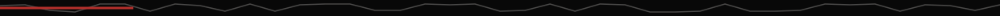
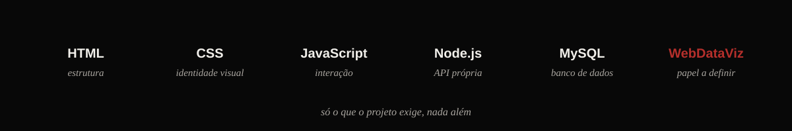
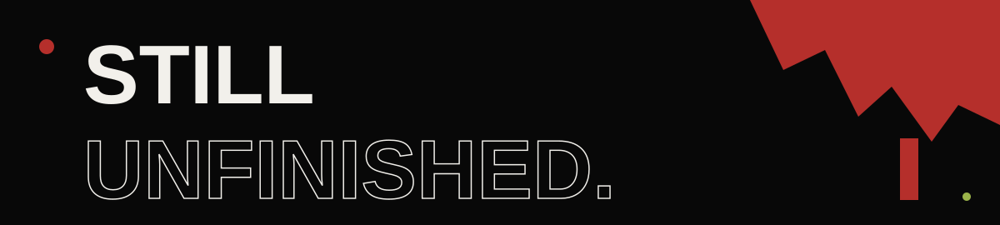

 

## O que é isto

**UNFINISHED** é uma página web pessoal, um blog autobiográfico em formato de zine. Nasceu como projeto individual da disciplina de Pesquisa e Inovação, mas a ideia de fundo é maior que a nota: contar uma história sem fingir que ela tem fim.

Não vende nada. Não quer ser portfólio, loja nem enciclopédia de skate. É um diário visual feito de fotos, recortes, textos e referências, e de uma pergunta que eu prefiro deixar aberta:

*quem eu sou enquanto ainda estou me fazendo?*

> Terminar é só a maneira educada de parar de tentar.

## O nome

*Unfinished* quer dizer inacabado. Em vez de esconder o rascunho, o projeto o expõe: cada página é uma versão, nenhuma é a final.

Há algo de honesto nisso. Toda biografia escrita no presente é um capítulo, e o último nunca está disponível para quem escreve. Um projeto que se declara inacabado não tem como falhar em terminar. Só tem como continuar.

> **[ espaço reservado ]**
> A história de verdade, com datas, lugares, pessoas, o que mudou e o que ficou, ainda vai ser escrita por mim. Este README descreve a ideia. A vida entra nas páginas do site.

## O skate no centro

O skate é o eixo porque ensina, sem discurso, o que o projeto quer dizer. Ninguém acerta uma manobra de primeira. A queda não é o contrário do progresso, é a forma que ele toma. A rua é um arquivo vivo: cada risco no chão, cada borda gasta, cada tentativa é registro de alguém que esteve ali insistindo.

Em volta do skate orbitam as outras coisas que compõem a história: o que eu escuto, o que eu visto, o que eu olho. Nenhuma é enfeite. Todas são pistas.

| Seção | O que guarda |
| --- | --- |
| **Skate journal** | o eixo central: a trajetória contada a partir do skate |
| **Soundtrack** | músicas e artistas que fazem parte das minhas referências |
| **Personal style** | roupas, looks, a maneira de me apresentar |
| **References** | referências visuais e cultura alternativa |
| **In progress** | a linha do tempo, a ser preenchida quando a história estiver definida |

A estrutura final das páginas ainda vai ser decidida junto com o conteúdo real.

## A estética

A referência é uma revista independente: colagem, papel rasgado, ruído de impressão, tipografia grande demais para caber, texto pequeno solto no escuro. Tudo propositalmente imperfeito, sem prejudicar a leitura e a navegação.

| Cor | Código | Papel no projeto |
| --- | --- | --- |
| Preto | `#080808` | o fundo, o silêncio onde o resto aparece |
| Papel | `#f2f0eb` | texto e recortes |
| Vermelho | `#b52f2b` | o rasgo, o destaque, o que chama atenção |
| Verde | `#9bb34a` | quase nunca |

O verde aparece como uma faísca: um ponto, um cursor. Se estivesse em todo lugar, deixaria de ser sinal.

## Tecnologias

| Tecnologia | Papel |
| --- | --- |
| **HTML** | estrutura das páginas |
| **CSS** | identidade visual, layout, responsividade e animações |
| **JavaScript** | interatividade, validações e manipulação de dados no front-end |
| **Node.js** | back-end e API própria |
| **MySQL** | banco de dados relacional |
| **WebDataViz** | dashboard; o papel exato ainda será definido com as orientações do professor |

Nenhuma API externa entra no projeto sem autorização. A única API aqui é a que eu mesmo construo em Node.js.

## Onde as coisas estão hoje

Esta lista é a parte menos poética do arquivo e a mais importante: o que está sem marcação ainda não existe.

- [x] Conceito e identidade visual definidos
- [x] Rascunho visual da Home (HTML e CSS)
- [ ] História pessoal escolhida e escrita
- [ ] Estrutura final das páginas
- [ ] Cadastro e login com API em Node.js e MySQL (senhas com hash)
- [ ] Dashboard com dados reais
- [ ] Apresentação final

## O caminho

| Semana | Foco |
| --- | --- |
| **S1, Start** | definição inicial do projeto e do tema |
| **S2, Tema** | refinamento da proposta, documentação e organização do GitHub |
| **S3, Início do site** | estrutura inicial, página Home e identidade visual |
| **S4, Dados** | funcionalidades de dados, integração com o banco e organização do código |
| **S5, Dashboard** | desenvolvimento, integração e validação do dashboard |
| **S6, Apresentação** | slides, demonstração e ensaio. Apresentação em 30 de novembro e 4 de dezembro, cerca de 10 minutos |

O cronograma é uma referência, não uma régua. Etapas podem andar antes, desde que nada atrase.

## Princípios

- Nada de API externa sem autorização do professor.
- Autenticação de verdade: senha com hash no back-end, e não só uma tela bonita.
- Estruturas de repetição e vetores onde fazem sentido, não por obrigação.
- Código que eu consigo explicar linha por linha.
- A imperfeição é estética. Bug não é.

## Como rodar

Ainda não há o que rodar. Quando a API e o banco existirem, esta seção vira instrução de verdade: instalação das dependências, variáveis de ambiente, script de criação do banco e o comando para subir o servidor.

feito à mão, em versão beta, por **Fuchs** · [@enzofuchsb](https://github.com/enzofuchsb)

